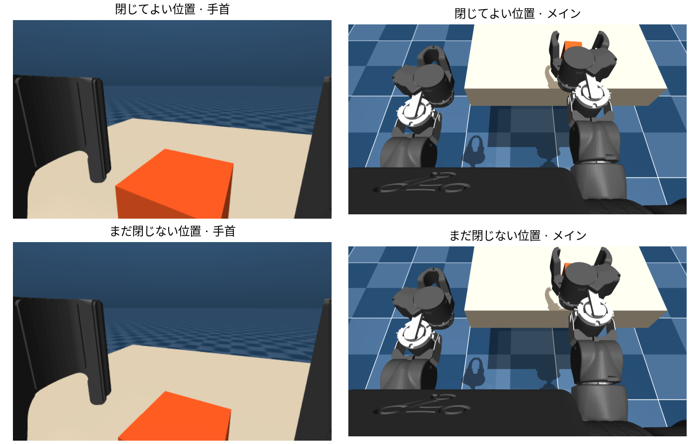
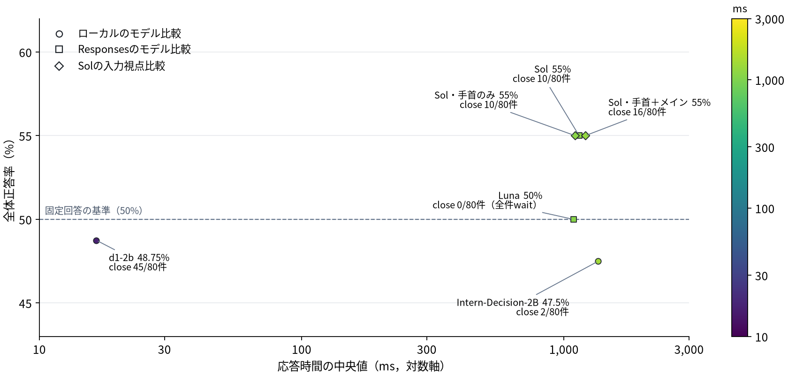

# OpenArmのRGB画像による閉指判断

2026-11-27．MuJoCoで固定した40の箱配置について，現在の指と物体の位置関係から，今グリッパーを閉じるかをモデルに尋ねた．各配置の正例・負例を1枚ずつ使い，6条件で計480件の有効な判断を得た．

**Sol Responses（`none`）の正答率は，手首のみでも手首＋メインでも55.0%（44/80）だった．** メイン画像の追加で9件が正答に変わり，別の9件が誤答に変わった．Luna Responsesは全件 `wait` で50.0%だった．同一GPUで測ったd1-2bとIntern-Decision-2Bはそれぞれ48.75%と47.50%だった．[集計と全480件の判定](evidence.json)

## 評価実験

### 固定した画像と場面

OpenArm v2 Pedestalの右腕と40 × 40 × 64 mm，60 gの箱を使った．箱の配置を50通り作り，10配置を開発用，40配置を評価用に固定した．同じ配置の2枚では箱の位置・向きと，グリッパーの向き・開き幅を揃え，手の位置を変えた．2枚は独立した静止状態で，各画像について1回ずつ判断を取得した．[固定画像と正解ラベルのSHA-256](../../fixtures/pilot-113/SHA256SUMS) · [配置の分割](../../fixtures/pilot-113/evaluator/splits.json) · [観測マニフェスト](../../fixtures/pilot-113/observation/manifest.jsonl)

| 入力条件 | モデルに渡すRGB画像 | 解像度 |
|---|---|---|
| 手首のみ | 右手首カメラの画像1枚 | 480 × 300 |
| 手首＋メイン | 同じ時点の右ヘッド，右手首の順に2枚 | 1280 × 720，480 × 300 |

メイン画像には，OpenArm v2 Cellの右ヘッドカメラをPedestalに移した固定視点を使った．保存状態から画像を描画し，手首PNG・正解ラベル・分割表が元のデータとバイト単位で一致することを確認した．深度画像や指の閉じ位置を示す重畳は使っていない．[描画処理](../../views.py) · [カメラ設定と画像ハッシュ](evidence.json)



図は配置 `grp_0000` の入力例である．下段では上段から手の目標位置だけを真上に14 mmずらした．閉指後の物理試験で，上段の箱は39.1 mm持ち上がり，下段の箱は台に残った．[上段の手首PNG](../../fixtures/pilot-113/observation/images/smp_471e9fb455ce.png) · [下段の手首PNG](../../fixtures/pilot-113/observation/images/smp_b18e5cb491b1.png) · [物理評価の記録](../../fixtures/pilot-113/evaluator/labels.jsonl)

### 入力文と選択肢

合意した `grip-pilot-v4` の質問と候補説明を以下に示す．物体の色や種類を入力文で指定せず，画像に写った指と物体の位置関係から，その場で閉じるかを尋ねた．[評価ランナー](../../benchmark.py)

```text
Given the current arrangement of the gripper fingers and the object, should the robot close the gripper now to grasp the object?
close: Close now. The jaws are positioned to grasp the object.
wait: Keep the jaws open. They are not positioned to grasp the object now, or the image evidence is insufficient to decide.
```

モデル間の手首比較では，質問の冒頭に `Look at the robot's wrist-camera image.` を付けた．Solの視点比較では，上に示したカメラ名を含まない質問を両条件に使った．Responsesではさらに `Return a JSON object with only the key "choice" and one of the values above.` を付け，厳密なJSON Schemaで `{"choice":"close"}` または `{"choice":"wait"}` を受け取った．ローカルモデルには同じ質問と候補説明をネイティブ選択形式で渡した．ラベル，配置ID，シミュレータの数値状態は採点側で保持した．[2択スキーマ](../../structured_choice.py) · [各条件の実際の文面](evidence.json)

### 実行条件

| 比較 | 固定した条件 | 変えた要因 |
|---|---|---|
| ローカルのモデル比較 | MercuryのRTX 4090，BF16，手首1枚，ネイティブ2択 | d1-2b（`LiquidAI/d1-2B`）／Intern-Decision-2B（`internlm/Intern-Decision-2B`） |
| Responsesのモデル比較 | 手首1枚，JSON Schemaの2択，reasoning effort `none`，温度0，出力上限32トークン，タイムアウト20秒 | Luna（`gpt-6-luna`）／Sol（`gpt-6-sol`） |
| Solの視点比較 | `gpt-6-sol`，同じResponses設定と質問全文，同じ手首PNG | 右ヘッド画像を追加 |

各条件で評価80ケースを同じ順序で1件ずつ処理した．ローカルではモデルを1つずつロードし，初回応答を含めた．Internでは一部の畳み込みがPyTorchの参照CUDA実装にフォールバックしており，計時は今回のランタイムでの値である．Responsesでは各条件の開発画像1件による接続確認を集計から除いた．視点比較では手首のみを先に，手首＋メインを後に実行した．[モデルのリビジョンとランタイム設定](evidence.json)

### 採点と計時

各画像の保存状態から，手の目標位置を保って閉指し，40 mm持ち上げる指令を出して0.40秒保持した．箱が25 mm以上上がり，保持中の支持面とのすき間が15 mm以上，終了時に支持面との接触がなく，終了時と保持中の80%以上で左右の指が箱に接触し，手に対する箱のずれが25 mm以内なら成功とした．成功を `close`，失敗を `wait` の正解とした．評価80件では初期状態や追従の異常による無効ラベルはなかった．[物理判定の実装](../../oracle.py)

閉じてよい40件のうち `close` を返した割合を $T$，まだ閉じない40件のうち `close` を返した割合を $F$ とすると，全件有効だった今回の正答率（%）は $100[T+(1-F)]/2$ となる．全件 `close` と全件 `wait` はともに50%である．配置内の2枚に両方正答した件数と，回答の内訳も示す．回答不一致率は，80件から異なる2件を選んだときに回答が異なる割合で，閉指件数を $C$，待機件数を $W$ とすると $2CW/(80\times79)$ になる．固定回答は0%になるが，この値から正誤は分からない．

応答時間は画像入力の組み立てからモデル応答の検証までの経過時間である．描画，モデルのロード，結果の採点・保存は計時から外した．ResponsesではHTTP通信を含む．各条件の中央値（P50）と線形補間による95パーセンタイル（P95）を示す．[評価実装](../../benchmark.py) · [試行別の経過時間](evidence.json)

## 正答率と応答時間



横軸と色は共通の対数目盛で応答時間の中央値（ms）を示す．横破線は固定回答の50%基準．点のラベルには正答率と，全80件のうち `close` を選んだ件数を示した．`close` が0件なら全件 `wait`，80件なら全件 `close` である．同じ形の点が比較の一組に対応し，丸はローカルのモデル比較，四角はResponsesのモデル比較，ひし形はSolの入力視点比較を表す．同条件での性能差は各組の中で読む．[図と表の集計元](evidence.json)

### ローカルのモデル比較（手首のみ）

| モデル | 正答率 | 閉じてよい位置で `close` | まだ閉じない位置で `close` | 回答 `close` / `wait` | 両画像正答 | P50 / P95（ms） |
|---|---:|---:|---:|---:|---:|---:|
| d1-2b | 48.75%（39/80） | 22/40 | 23/40 | 45 / 35 | 9/40 | 16.5 / 19.0 |
| Intern-Decision-2B | 47.50%（38/80） | 0/40 | 2/40 | 2 / 78 | 0/40 | 1,351.8 / 1,365.1 |

d1-2bは22件の正例で閉じたが，負例でも23件を閉じた．回答不一致率49.8%は，両回答をほぼ均等に使った結果である．Intern-Decision-2Bが閉じた2件は両方とも負例だった．

### Responsesのモデル比較（手首のみ）

| モデル | 正答率 | 閉じてよい位置で `close` | まだ閉じない位置で `close` | 回答 `close` / `wait` | 両画像正答 | P50 / P95（ms） |
|---|---:|---:|---:|---:|---:|---:|
| Luna | 50.0%（40/80） | 0/40 | 0/40 | 0 / 80 | 0/40 | 1,087.3 / 1,662.3 |
| Sol | 55.0%（44/80） | 7/40 | 3/40 | 10 / 70 | 5/40 | 1,142.9 / 1,542.4 |

Lunaは全件 `wait` で，50%は固定回答の結果である．Solは基準を4件上回った．正例40件中33件では `wait` を返した．

### Solにメイン画像を追加

| 視点 | 正答率 | 閉じてよい位置で `close` | まだ閉じない位置で `close` | 回答 `close` / `wait` | 両画像正答 | P50 / P95（ms） |
|---|---:|---:|---:|---:|---:|---:|
| 手首のみ・再測定 | 55.0%（44/80） | 7/40 | 3/40 | 10 / 70 | 6/40 | 1,103.7 / 1,603.7 |
| 手首＋メイン | 55.0%（44/80） | 10/40 | 6/40 | 16 / 64 | 7/40 | 1,206.6 / 1,630.6 |

両条件で正答35件，両条件で誤答27件，メイン画像の追加で正答に変わったものが9件，誤答に変わったものが9件だった．正例・負例で `close` がそれぞれ3件増えたため，差し引きの正答数は44件のままだった．応答時間の中央値は約103 ms増えた．上のモデル間比較に載せたSolとは別の実行で，手首のみも同じ質問で取り直した．[同じ画像IDによる照合](evidence.json)

## ここまでの検証との関係

初期の検証では，箱の配置を一つに固定した6姿勢で，手首，外部斜め視点や右ヘッドを加えた入力，空閉じ重畳を試した．続く40配置の旧パイロットでは，Luna Decisions，Qwen2.5-VL 3B，d1-2b，Intern-Decision-2Bを実行し，固定回答でも50%になる問題を確認した．今回の集計は，PNGを固定し，特定の色や物体名を含まない質問と `close` / `wait` の2択に統一した実行が対象である．旧実行は画像の生成経路，回答形式，計時条件が揃っていないため，今回との定量比較は行っていない．[初期6姿勢の検証](../grip-benchmark-report.md) · [旧パイロットの実行記録](../results.json)

## 結果を適用できる範囲

今回分かったのは，**この固定画像に対するSol Responses（`none`）の一回の比較では，RGB視点を加えても閉指判断の総正答数が増えなかった**ことである．箱と指の奥行き・高さの関係が判定に必要な一方，必要な手がかりが画像に写っている程度と，モデルがそれを利用できる程度は，この比較だけでは切り分けられない．

対象は単一種類の箱，シミュレータの固定配置，静止したRGB観測である．接近中に閉じる時点の判断，別の物体や実機への一般化，深度や手先状態を加えたときの性能は，この結果の範囲外である．各条件は80枚を1周した測定で，APIの実行は逐次である．応答時間の差には画像の入力コストに加え，実行時の通信・サービスの変動も含まれる．

## 再集計用データ

[evidence.json](evidence.json) に，6条件の実行設定，画像ハッシュ，480件の画像ID・ラベル・回答・応答時間，表の集計値を収録した．手首画像と正解データは[固定データセット](../../fixtures/pilot-113/)にある．メイン画像は右ヘッドのカメラ設定と評価80枚分のSHA-256を記録し，図には実際の入力例を掲載した．標準の実行方法は[評価README](../../README.md)にある．視点比較では `run_benchmark` に渡す両視点の質問を `GRASP_QUESTION` に揃え，`wrist` と `main-wrist` を指定した．

構成の参考にしたJevのレポートは，数値観測を使って22候補から次の操作を選ぶ別の実験である．[Jevの固定22択における選択精度と応答時間](https://github.com/takumi-nishimura/expt-gui-manipulation/blob/c0f85fc9408c204dc59f85f922275aa2119e9677/validation/jev-fixed-scenes-v2-local-cloud-2026-11-27/README.md)
